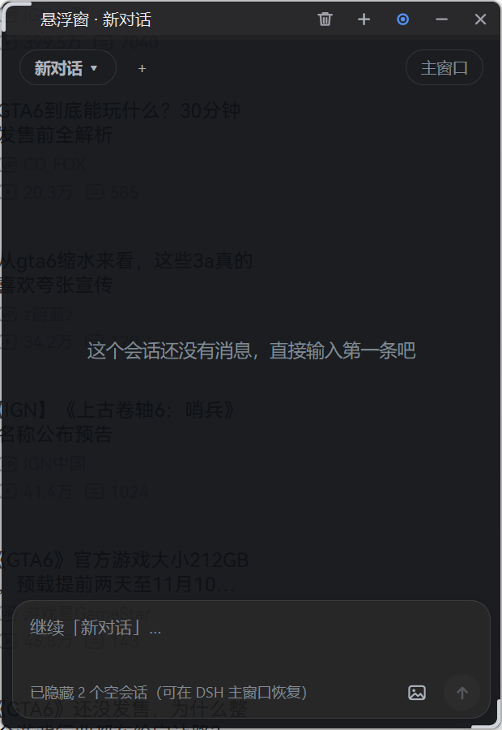
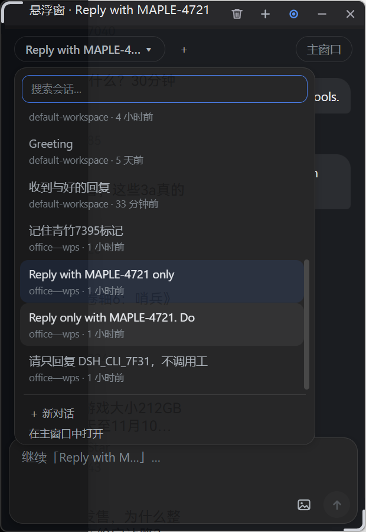

<div align="center">

# DSH Floating Window

**Pop any DSH conversation into an independent, always-on-top desktop floating window**

Multitasking powerhouse · Floats over any IDE / browser · Full session synchronization · Live streaming responses

[-0078d4.svg)](#system-requirements)
[](./LICENSE)
[](#installation)

<br/>

<p align="center">
  
  &emsp;
  
</p>

<p><em>Left: Frameless translucent floating chat window &emsp;|&emsp; Right: Multi-session list, workspace categorization & search</em></p>

</div>

---

## 💡 Why DSH Floating Window?

When using DSH (DeepSeek Harness) Desktop, the main window is often obscured whenever you switch to your code editor, terminal, or browser. Minimizing DSH hides your ongoing thought processes and chat flow completely.

**DSH Floating Window** is specifically built for desktop multitasking workflows, **drawing design inspiration from the desktop floating window UX of Doubao (豆包)**:
- **True native standalone process**: Stays on top of all applications, even when DSH Desktop is minimized.
- **Direct official session integration**: Interacts directly with the official DSH `sessionController`—supporting session switching, full transcript history, multimodal image attachments, and creating new sessions.
- **Seamless hand-off to main window**: Easily switch the active session back to the DSH main window at any time (just like Doubao's "Open in main window" workflow).

---

## 🗺️ Roadmap

- [x] **Windows Support**: WinForms + WebView2, supporting always-on-top, opacity adjustments, and geometry memory
- [x] **Full Session Experience**: Multi-session switching, streaming transcript, collapsible reasoning, image uploads, hand-off to main window
- [ ] **macOS Support (Under Active Planning 🚧)**: Lightweight native window shell built with Swift / WebKit (Node.js host routes and web frontend are already cross-platform ready)
- [ ] **Global Hotkeys**: Quick toggle to show/hide the floating window anywhere in the system

---

## 📋 System Requirements

| Component | Requirement | Note |
| :--- | :--- | :--- |
| **Operating System** | **Windows 10 / 11** (Supported)<br>*macOS (Planned 🚧)* | Current native shell is implemented via WinForms + WebView2; macOS version is on the roadmap |
| **Host Environment** | DSH Desktop | Requires desktop shell capability headers (Web version unsupported) |
| **Runtime** | WebView2 Runtime | Pre-installed on Windows 11; install via Microsoft official site if missing on Windows 10 |
| **Dependency** | `@deepseek-ai/dsh-client-ui-conversation` | Required plugin dependency for mounting the floating window composer button |

---

## 📥 Installation

```bash
# 1. Clone repository locally
git clone https://github.com/HeFenhenshuai/dsh-floating-window.git

# 2. Add plugin to DSH Desktop
dsh plugin --profile desktop add C:\path\to\dsh-floating-window

# 3. Completely restart DSH Desktop
```

> **Important**: DSH caches host plugin modules by path. **You must restart DSH Desktop after installing or updating** for the host routes to take effect.

---

## 🤝 Credits & License

- **Design Inspiration**: The floating window architecture and interaction workflow are inspired by the desktop floating window of **Doubao (豆包)** (frameless always-on-top, instant multi-session switching, and seamless hand-off back to the main window).
- **Upstream Project**: Based on and continued from [dsh-float-chat](https://github.com/cyh3436332528/dsh-float-chat) by [@cyh3436332528](https://github.com/cyh3436332528).
- Licensed under the [MIT License](./LICENSE).
