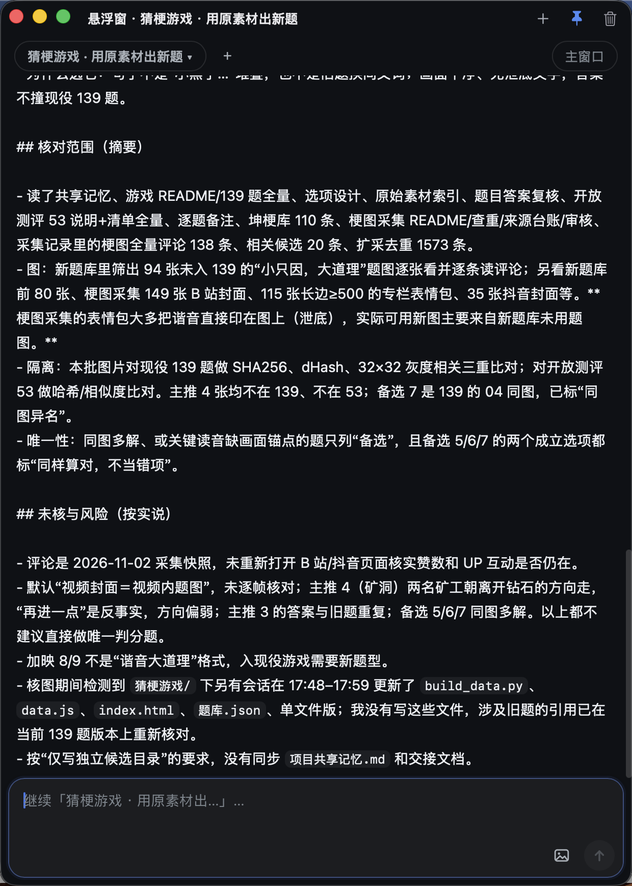
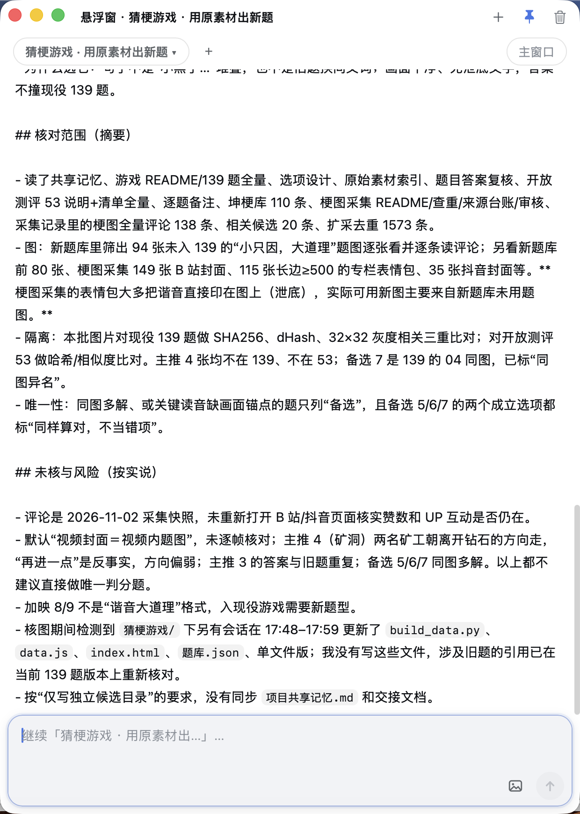

<div align="center">

# DSH Floating Window · macOS

**把 DSH 会话弹出为独立的 macOS 置顶悬浮窗**

原生 AppKit + WKWebView · 不是 Electron 套壳 · 压在任何 IDE / 浏览器之上 · 完整会话同步 · 实时流式响应

[](#系统要求)
[](./LICENSE)
[](#安装)

<br/>

<p align="center">
  
  &emsp;
  
</p>

<p><em>系统标题栏 + 红绿灯 + 右侧三颗按钮（新建会话 / 置顶 / 清理缓存），深浅两套主题跟随 DSH</em></p>

</div>

---

## 💡 为什么需要它？

用 DSH Desktop 时，一切到编辑器、终端或浏览器，DSH 窗口就被挡住；最小化后更是没法随手追问。

这个插件把当前会话弹成**一个独立的、始终置顶的 macOS 原生窗口**：
- **真正的原生窗口**：`NSWindow` + `WKWebView`，独立进程，DSH 最小化 / 隐藏 / 全屏后依然可用；切桌面（Spaces）时跟着走。
- **就是你的真实会话**：直接读写 DSH 的 Session，会话切换、历史追溯、多模态图文输入、新建会话都通。
- **随时交接回主窗口**：一键把浮窗里的会话交还 DSH 主界面继续聊。

> 本仓库用分支区分两个版本：**`macos` 分支 = 本页（AppKit + WKWebView）**，[`main`](https://github.com/HeFenhenshuai/dsh-floating-window/tree/main) 分支 = Windows 版（WinForms + WebView2）。两者共用同一套页面与宿主路由，但各自独立编译原生外壳、独立安装（插件 id 不同，可以同时装）。

---

## ✨ 核心特性

- 🪟 **原生 macOS 悬浮窗**
  - 系统标题栏：红绿灯、拖拽、四边四角缩放、双击标题栏按系统偏好缩放。
  - 标题栏右侧三颗按钮：新建会话、始终置顶（图钉）、清理缓存。
  - 始终置顶基于 `window.level = .floating`，并加入 `canJoinAllSpaces` / `fullScreenAuxiliary`。
  - 可选 `Esc` 快速关闭；位置与大小自动记忆；不透明度 60% ~ 100%。
- 💬 **全功能会话管理**
  - 左上角下拉切换全部会话，支持即时搜索。
  - **新对话分区**：＋ 旁的文件夹按钮决定新会话建在哪个分区（默认 DSH 的默认工作区，可手动切换，选择在窗口内记住）。
  - 流式回答与推理聚合：「思考过程」与「工具调用」折叠成一行。
  - 图片多模态：拖入、粘贴或点图标发送（最多 4 张），对话里的图片正常显示。
  - 「主窗口」按钮把当前会话交还 DSH 主界面。
  - **审批 / 提问只差一步**：这一步只能在主窗口确认时，浮窗出现红色「去主窗口确认」按钮——点一下会把会话交给主窗口，并把 DSH 本身激活到最前。
- 🎨 **外观与主题**
  - 四态：`跟随 DSH` / `跟随系统` / `浅色` / `深色`。
  - 在 DSH 设置里换深浅色，浮窗与标题栏秒级联动，无需重启。
- 🧹 **安全清缓存**
  - 设置页可看缓存与日志体积。
  - 只清 WebKit 纯渲染缓存（`~/Library/Caches/com.dsh.floating-window`），**不动 Cookie 与 LocalStorage**，不会退出登录。

---

## 📋 系统要求

| 组件 | 要求 | 说明 |
| :--- | :--- | :--- |
| **操作系统** | **macOS 12+** | Apple Silicon 用仓库里的预编译 `.app`；Intel Mac 用 `--universal` 重编 |
| **宿主环境** | DSH Desktop（桌面版） | 需要 Desktop 外壳签发的渲染器能力头，Web 版不可用 |
| **运行时** | 系统自带 WKWebView | 无需 WebView2 之类的额外运行时 |
| **编译工具**（仅改源码时） | Xcode Command Line Tools（`xcode-select --install`） | 提供 `swiftc` |
| **依赖插件** | `@deepseek-ai/dsh-client-ui-conversation` | 硬依赖，用于在输入框右侧注入「浮窗」按钮 |

---

## 📥 安装

```bash
# 1. 克隆仓库的 macos 分支
git clone -b macos https://github.com/HeFenhenshuai/dsh-floating-window.git
cd dsh-floating-window

# 2. 一般不用编译（已带通用二进制）；改过 Swift 源码才需要：
(cd window && ./build.sh --universal)

# 3. 装进 DSH Desktop
dsh plugin --profile desktop add ~/dsh-plugins/dsh-floating-window-macos

# 4. 完全退出并重启 DSH Desktop
```

> **必须重启**：DSH 宿主按路径缓存插件模块，安装或更新后不重启，`/dsh-floating-window/*` 路由不会生效。
>
> 也可以在 DSH「设置 → 插件 → 添加插件」里直接选这个目录。

---

## 🚀 使用

1. 重启后，主窗口输入框右侧多一颗 **浮窗** 按钮：点开即弹出独立窗口，并默认带上当前会话。
2. 点浮窗左上角会话名即可切换历史会话；「＋」复用/新建会话。
3. 点「主窗口」把当前会话交还 DSH 主界面。
4. 设置：DSH「设置 → 悬浮窗」。

### macOS 操作表

| 操作 | 方式 |
| :--- | :--- |
| 移动窗口 | 拖拽标题栏空白处（红绿灯与本窗按钮之间） |
| 缩放窗口 | 拖拽任意边 / 角 |
| 双击标题栏 | 按系统偏好「缩放 / 最小化 / 不操作」 |
| 新建会话 / 置顶 / 清理缓存 | 标题栏右侧三颗按钮 |
| 选择新对话的分区 | ＋ 右侧的文件夹按钮（✓ 为当前选择，可「恢复默认分区」） |
| 关闭 / 最小化 / 全屏 | 系统红绿灯 |
| 快捷键 | `⌘W` 关闭、`⌘M` 最小化、`⌘Q` 退出、`Esc`（需在设置里开启） |
| 再次唤起已开着的浮窗 | 再点一次「浮窗」按钮：窗口直接置前（不会重复开第二个） |

---

## ⚙️ 配置项

在 **DSH 设置 → 悬浮窗** 中可视化修改，即时写入
`~/Library/Application Support/dsh-floating-window/float-settings.json`：

| 配置项 | 取值 | 默认 | 说明 | 生效 |
| :--- | :--- | :--- | :--- | :--- |
| `appearance` | `dsh` / `system` / `light` / `dark` | `dsh` | 浮窗配色方案 | 即时 |
| `alwaysOnTop` | boolean | `true` | 是否压在其他窗口之上 | 即时 |
| `opacity` | 0.6 ~ 1.0 | `1.0` | 整体不透明度 | 即时 |
| `rememberGeometry` | boolean | `true` | 记住位置与大小 | 下次开窗 |
| `defaultWidth` / `defaultHeight` | 320~1600 / 260~1600 | 406 × 571 | 未记忆时的初始尺寸（出厂默认，可在设置页改） | 下次开窗 |
| `closeOnEscape` | boolean | `false` | 按 Esc 关闭浮窗 | 即时 |
| `showSessionTitle` | boolean | `true` | 标题栏显示会话名 | 即时 |

---

## ❓ 常见问题

<details>
<summary><b>Q1: 点「浮窗」没反应 / 提示打开失败？</b></summary>

1. 确认在 **DSH Desktop**（不是 Web 版）里。
2. 确认装完插件后**完全重启**过 DSH。
3. 确认 `window/dsh-floating-window.app` 还在（不要把 `plugin/` 单独拷走）。
4. 看日志：`~/Library/Application Support/dsh-floating-window/window-log.txt`。
</details>

<details>
<summary><b>Q2: 浮窗白屏或 forbidden？</b></summary>

不要直接在 Finder 里双击 `.app`。窗口依赖宿主实时签发的 Token 鉴权 URL，必须从输入框右侧的「浮窗」按钮拉起。
</details>

<details>
<summary><b>Q3: 首次打开提示「无法验证开发者」？</b></summary>

仓库里的 `.app` 是本地 ad-hoc 签名。任选其一：

- 右键点 `.app` → 打开；
- 或 `xattr -dr com.apple.quarantine window/dsh-floating-window.app`；
- 或自己重编：`cd window && ./build.sh`。
</details>

<details>
<summary><b>Q4: 清缓存会退出登录吗？</b></summary>

不会。只删 `~/Library/Caches/com.dsh.floating-window`（WebKit 的 NetworkCache / CacheStorage 等纯缓存）。Cookie 在 `~/Library/WebKit/.../WebsiteData/`，不在清理范围内。
</details>

---

## 🏗️ 架构

```text
dsh-floating-window-macos/
├── plugin/
│   ├── host.js              # 宿主端：鉴权令牌、拉起 .app、会话 / 主题 / 设置 / 缓存路由
│   ├── client.js            # 前端扩展：输入框「浮窗」按钮 + 「悬浮窗」设置页
│   └── page/float.html      # 浮窗页面：精简流式聊天界面（与 Windows 版同一份）
├── window/                  # 原生外壳（Swift，AppKit + WKWebView）
│   ├── dsh-floating-window.app
│   ├── src/                 # 见 window/README.md
│   ├── build.sh · test.sh
│   └── icon.icns
└── docs/assets/             # 实机截图
```

三层各司其职：`host.js` 是唯一知道 DSH 内部服务（`sessionController` 等）的一半；页面只跟宿主路由说话；
原生外壳只管窗口与网络（Cookie、渲染器能力头、主题重绘）。所以换平台只换第三层。

编译与自检：

```bash
cd window
./build.sh              # 当前架构
./build.sh --universal  # 通用二进制
./test.sh               # 纯逻辑自检，不需要窗口服务器
```

---

## 🤝 致谢与协议

- 交互参考 **豆包（Doubao）桌面端悬浮窗**。
- 上游项目 [dsh-float-chat](https://github.com/cyh3436332528/dsh-float-chat)（[@cyh3436332528](https://github.com/cyh3436332528)）。
- [MIT License](./LICENSE)。
