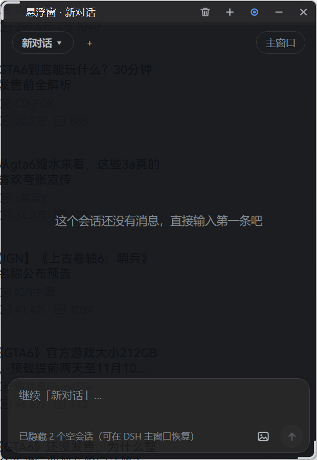
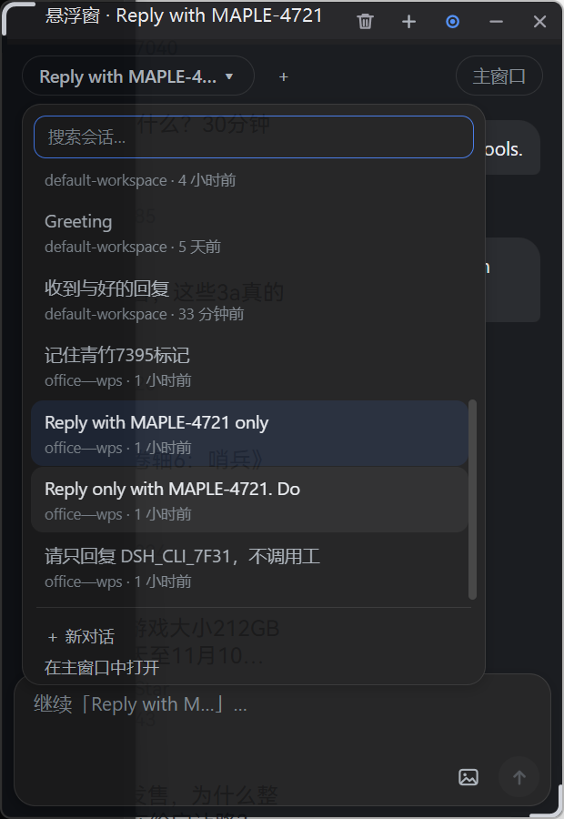

<div align="center">

# DSH Floating Window

**把 DSH 会话弹出为独立的桌面置顶悬浮窗**

跨窗口多任务办公利器 · 压在任何 IDE / 浏览器之上 · 完整会话同步 · 实时流式响应

[-0078d4.svg)](#系统要求)
[](./LICENSE)
[](#安装指南)

<br/>

<p align="center">
  
  &emsp;
  
</p>

<p><em>左：半透明置顶悬浮窗主界面 &emsp;|&emsp; 右：深色多会话切换、工作区归类与即时搜索</em></p>

</div>

---

## 💡 为什么需要它？

在使用 DSH（DeepSeek Harness）Desktop 时，一旦你切到代码编辑器、终端或浏览器查阅资料，DSH 窗口就会被遮挡；最小化后更是无法随时提问或查看结果。

**DSH Floating Window** 专为桌面多任务场景打造，**交互构成参考了「豆包」桌面端悬浮窗的优秀设计**：
- **真正的原生独立进程**：始终压在所有应用最顶层，DSH 最小化后依然可用。
- **全功能打通官方会话**：直接操作 DSH 真实会话，支持会话切换、历史追溯、多模态图文输入与新建会话。
- **随时交接回主窗口**：一键将浮窗中进行的对话无缝切回 DSH 主界面（如同豆包浮窗的「在主窗口中打开」体验）。

---

## ✨ 核心特性

- 🪟 **原生桌面级悬浮窗**
  - **无边框圆角美学**：整条标题栏支持拖拽移动，双角支持原生平滑缩放。
  - **独立控制按钮**：标题栏自带「新建会话」、「始终置顶切换（图钉）」、「一键清理缓存」、「最小化」与「关闭」。
  - **快捷交互**：可选开启按 `Esc` 快速关闭浮窗；位置、大小与不透明度自动记忆。
- 💬 **全功能会话管理**
  - **多会话无缝流转**：左上角下拉菜单直观浏览全部会话，支持搜索与会话切换。
  - **多模态图文支持**：支持拖入、粘贴或点击图标发送图片附件（最多 4 张），完整展示对话中的图片。
  - **流式回答与推理聚合**：实时流式输出；长篇的「思考过程」与「工具调用」自动折叠为一行，界面清爽聚焦。
  - **一键回主窗口**：右上角「主窗口」按钮可随时将当前会话交还给 DSH 主界面继续操作。
- 🎨 **外观与深度自适应**
  - 四态主题切换：`跟随 DSH` / `跟随 系统` / `浅色` / `深色`。
  - 在 DSH 中修改主题外观，悬浮窗与原生标题栏**毫秒级即时联动**，无需重启。
  - 支持调整窗口整体不透明度（60% ~ 100%）。
- 🧹 **安全无害的缓存管理**
  - 设置页实时查看浏览器缓存与日志体积。
  - 专属清理逻辑：仅清理 7 类纯渲染与着色器缓存，**绝不清除 Cookie 与 LocalStorage**，不会导致退出登录或丢失会话关联。

---

## 🗺️ 开发路线图 (Roadmap)

- [x] **Windows 首发支持**：基于 WinForms + WebView2，支持置顶、透明度调节、几何记忆
- [x] **完整会话功能**：多会话切换、流式接收、思考折叠、图片多模态上传、主窗口会话交接
- [ ] **macOS 原生外壳支持（积极规划中 🚧）**：构建基于 Swift / WebKit 的轻量原生置顶外壳（核心宿主路由与 Web 页面已具备跨平台能力）
- [ ] **全局快捷键**：支持快捷键一键呼出 / 隐藏浮窗
- [ ] **快捷发送选中文字**：选中文本后快速发往悬浮窗提问

---

## 📋 系统要求

| 组件 | 要求 | 说明 |
| :--- | :--- | :--- |
| **操作系统** | **Windows 10 / 11**（现已支持）<br>*macOS（计划中 🚧）* | 目前原生外壳采用 WinForms + WebView2 实现；macOS 原生外壳版本已列入开发计划 |
| **宿主环境** | DSH Desktop（桌面版） | 依赖 Desktop 外壳的渲染器能力头，Web 版不可用 |
| **运行时** | WebView2 Runtime | Windows 11 已内置；Windows 10 若缺失请前往微软官网安装 |
| **依赖插件** | `@deepseek-ai/dsh-client-ui-conversation` | 硬依赖，用于向输入框右侧注入「浮窗」入口 |

---

## 📥 安装指南

### 本地链接安装（推荐）

1. 下载或 Clone 本仓库到本地任意目录（例如 `D:\plugins\dsh-floating-window`）：
   ```bash
   git clone https://github.com/HeFenhenshuai/dsh-floating-window.git
   ```
2. 打开终端，使用 DSH CLI 添加本插件（或在 DSH Desktop 设置中的「插件 → 添加插件」中选择该目录）：
   ```bash
   dsh plugin --profile desktop add D:\plugins\dsh-floating-window
   ```
3. **⚠️ 关键步骤：重启 DSH Desktop**
   > **注意**：由于 DSH 宿主插件模块常驻进程且缓存路径，**安装或更新后必须完全重启一次 DSH Desktop**，宿主路由才会生效。

---

## 🚀 快速上手

1. **唤起浮窗**：重启 DSH 后，在主窗口输入框右侧会新增一颗 **浮窗** 按钮，点击即可弹出独立窗口，并默认同步当前会话上下文。
2. **多会话切换**：点击浮窗左上角当前会话名（如 `新对话 ▾`），即可在下拉列表中切换历史会话或点击「＋」新建会话。
3. **切回主窗口**：点击浮窗顶部的「**主窗口**」按钮，当前会话将立刻切回 DSH 主界面打开。
4. **自定义设置**：进入 DSH「设置」→ 左侧导航选择「**悬浮窗**」，可自由调节主题、不透明度、置顶状态及查看缓存占用。

---

## ⚙️ 配置项一览

插件的配置可直接在 **DSH 设置 → 悬浮窗** 中可视化修改：

| 配置项 | 类型 / 取值范围 | 默认值 | 说明 | 生效时机 |
| :--- | :--- | :--- | :--- | :--- |
| **外观方案** (`appearance`) | `dsh` / `system` / `light` / `dark` | `dsh` | 浮窗颜色主题（`dsh` 即跟随 DSH 外观） | 即时生效 |
| **始终置顶** (`alwaysOnTop`) | boolean | `true` | 是否保持压在其他所有应用窗口之上 | 即时生效 |
| **不透明度** (`opacity`) | number (0.6 ~ 1.0) | `1.0` | 窗口整体透明度滑块 | 即时生效 |
| **记住窗口位置** (`rememberGeometry`) | boolean | `true` | 下次打开时是否恢复上次拖拽的尺寸与坐标 | 下次开窗 |
| **默认尺寸** (`defaultWidth` / `Height`) | 宽度 320~1600 / 高度 260~1600 | 620 × 900 | 未记忆几何尺寸时的初始窗口大小 (px) | 下次开窗 |
| **按 Esc 关闭** (`closeOnEscape`) | boolean | `false` | 浮窗激活状态下按 `Esc` 键直接关闭窗口 | 即时生效 |

---

## ❓ 常见问题 (FAQ)

<details>
<summary><b>Q1: 什么时候支持 macOS？</b></summary>

* **macOS 原生支持已在开发路线图中**。由于插件架构中：
  - 宿主服务端（`host.js`）基于标准 Node.js
  - 浮窗页面（`float.html`）与 DSH 注入脚本（`client.js`）均为纯标准 Web/JS 代码
  - **核心跨平台逻辑已全部就绪**，目前仅需使用 Swift / WebKit 为 macOS 编写一个轻量级原生置顶窗口外壳即可完成适配。欢迎关注 Star 本仓库动态！
</details>

<details>
<summary><b>Q2: 点击「浮窗」按钮后没有反应，或提示打开失败？</b></summary>

1. **请确认是否在 DSH Desktop（桌面版）中运行**：Web 版由于缺少安全渲染器头，接口会直接拒绝开窗请求。
2. **请确认是否已重启 DSH**：初次安装插件后必须完全退出并重启 DSH Desktop。
3. **检查文件完整性**：插件依赖同级目录下的 `window/dsh-floating-window.exe`，请勿将 `plugin/` 目录单独移动剥离。
</details>

<details>
<summary><b>Q3: 悬浮窗打开后显示白屏或提示 forbidden？</b></summary>

* 请勿在文件夹中直接双击运行 `dsh-floating-window.exe`。原生窗口依赖 DSH 宿主实时签发的专属 Token 鉴权 URL，必须通过 DSH 输入框右侧的「浮窗」按钮拉起。
</details>

<details>
<summary><b>Q4: 清理缓存会不会把我退出登录或删掉对话？</b></summary>

* **不会**。清理程序针对的是 Chromium 纯渲染相关的 7 个 Cache 目录；存储登录凭证的 `Cookie` 与记录状态的 `LocalStorage` 均在排除列表之外，账号状态不受任何影响。
</details>

---

## 🏗️ 架构与源码编译

本项目采用三层协同架构：
```text
dsh-floating-window/
├── plugin/
│   ├── host.js              # Node.js 宿主端：负责路由转发、鉴权令牌、拉起原生窗口进程
│   ├── client.js            # DSH 前端扩展：输入框浮窗入口按钮、设置页面板
│   └── page/float.html      # 悬浮窗内容页：精简版流式聊天界面、多模态附件、会话切换
├── window/                  # Windows 原生窗口进程（macOS 版本规划中）
│   ├── dsh-floating-window.exe  # 预编译的原生外壳程序
│   └── src/FloatWindow.cs   # 窗口源码（约 2000 行，WinForms + WebView2，C# 5）
└── docs/
    ├── preview.png          # 实机效果图（深色悬浮窗主界面）
    └── sessions.png         # 实机效果图（深色多会话切换与搜索）
```

> **二次编译说明**：仓库已内置编译好的 `.exe` 与运行依赖，**普通用户无需安装 C# 编译器即可直接使用**。  
> 若修改了 `FloatWindow.cs`，可在 `window/` 目录下调用 Windows 自带的 .NET Framework `csc.exe` 重新构建：
> ```cmd
> C:\Windows\Microsoft.NET\Framework64\v4.0.30319\csc.exe /nologo /target:winexe /platform:x64 /out:dsh-floating-window.exe /win32manifest:app.manifest /r:Microsoft.Web.WebView2.Core.dll /r:Microsoft.Web.WebView2.WinForms.dll /r:System.dll /r:System.Drawing.dll /r:System.Windows.Forms.dll /r:System.Core.dll src\FloatWindow.cs
> ```

---

## 🤝 致谢与开源协议

- **交互设计与灵感**：本插件的悬浮窗交互构成与使用场景参考了 **豆包（Doubao）桌面端悬浮窗**（无边框置顶悬浮、多会话即时流转、一键交接回主窗口打开）。
- **上游开源项目**：本项目基于社区项目 [dsh-float-chat](https://github.com/cyh3436332528/dsh-float-chat)（原作者 [@cyh3436332528](https://github.com/cyh3436332528)）的初始实现演进与维护，特此鸣谢。
- 遵循 [MIT License](./LICENSE) 开源协议。
